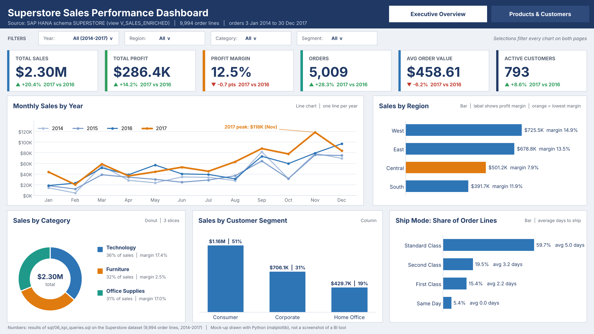
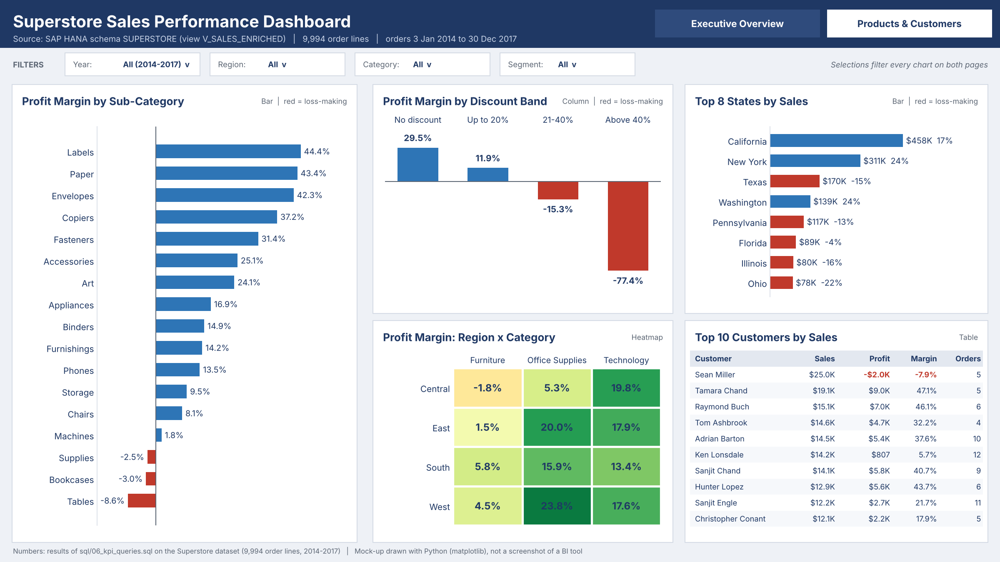
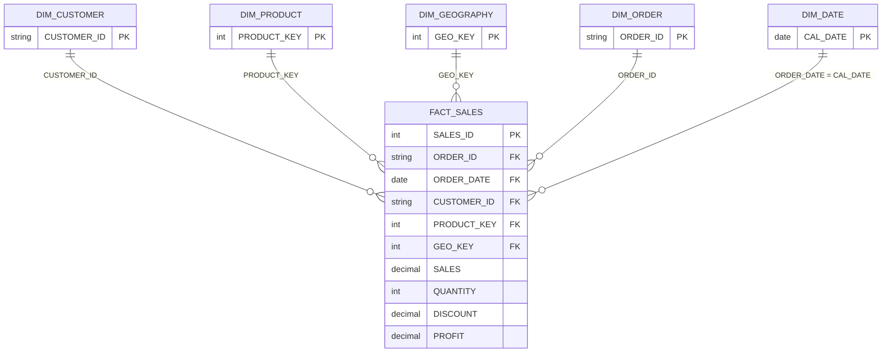

# Superstore Sales Performance Dashboard on SAP HANA

A KPI dashboard project for the **SAP HANA Data Analyst Internship, Task 4 (Week 4): Dashboard Creation**.
It turns five raw Excel files of Superstore order data into a cleaned star schema, SAP HANA SQL views,
a tested set of KPI queries, and a two-page dashboard design.

Prepared by Mehul Vishwakarma (Yuva Intern).

**Report:** [`Task4_SAP_HANA_KPI_Dashboard_Report.docx`](Task4_SAP_HANA_KPI_Dashboard_Report.docx) is the Word document for the task. It covers the business scenario and KPIs, data sources, tool selection (Tableau), wireframes, chart rationale, implementation steps with code, the dashboard mock-ups, insights, validation, improvements and future enhancements.

## Dashboard design

Page 1, Executive Overview: six KPI cards, monthly trend, region, category, segment and shipping.



Page 2, Products & Customers: where profit is made and lost.



> **These images are mock-ups.** They were drawn with Python from the real query results
> (`scripts/03_render_dashboard_mockups.py`). They are not screenshots of Tableau or SAP Analytics Cloud.

## Business scenario

Superstore sells furniture, office supplies and technology to consumers, corporate customers and home
offices in four US regions. Management reviews performance every month and wants to see on one screen:
**Are we growing? Is the growth profitable? Where does it come from? What is costing us money?**

| Stakeholder | Decision | Needs to see |
| --- | --- | --- |
| Sales director | Growth targets | Headline KPIs, yearly growth, monthly trend |
| Regional managers | Where to put sales effort | Sales and margin by region and state |
| Merchandising manager | Pricing, assortment, discounts | Margin by sub-category and discount band |
| Customer manager | Key accounts, delivery service | Top customers, ship mode and speed |

## Data

Five Excel files in [`data/raw/`](data/raw). They are row-aligned splits of one Superstore order table
(row *n* of every file describes sales row *n*).

| File | Rows | Content |
| --- | ---: | --- |
| `sales.xlsx` | 9,994 | Order lines: IDs, sales, quantity, discount, profit |
| `customers.xlsx` | 9,994 | Customer ID, name, segment (793 distinct customers) |
| `dates.xlsx` | 9,994 | Order ID, order date, ship date, ship mode (5,009 distinct orders) |
| `location.xlsx` | 9,994 | Postal code, city, state, region (632 distinct locations) |
| `product.xlsx` | 9,994 | Product ID, name, category, sub-category (1,894 distinct products) |

### Problems found in the raw data and how they were solved

| Problem | Evidence | Fix |
| --- | --- | --- |
| **Dates are corrupted.** Real dates and text are mixed, and the real dates have day and month swapped (11 Aug instead of 8 Nov). | Without a fix, 1,708 order lines ship before they are ordered. | Swapped dates are repaired, text dates are read as month/day/year. After the fix: 0 orders ship early and delivery takes 0 to 7 days. |
| Postal codes lost their leading zero | Minimum value was 1040 | Stored as 5-character text (`01040`) |
| Dimension files are row-aligned copies full of duplicates | 9,994 rows for 793 customers | De-duplicated and linked by keys |
| 32 product IDs have two product names | 1,862 IDs but 1,894 products | Surrogate key `PRODUCT_KEY` |
| 1 postal code has two city/state values | 631 vs 632 locations | Surrogate key `GEO_KEY` |
| Sales values have up to 4 decimals | Rounding to 2 would change 4,000+ rows | Stored as `DECIMAL(15,4)`; nothing is rounded |

The cleaning rules are in [`scripts/01_prepare_data.py`](scripts/01_prepare_data.py) and every rule is protected by an assertion.

### Data model (star schema)



Grain of the fact table: one row is one product on one order, so counting rows counts order lines, not orders.
All columns are described in the [data dictionary](docs/data_dictionary.md).

## KPIs

| KPI | Definition |
| --- | --- |
| Total Sales | `SUM(SALES)` |
| Total Profit | `SUM(PROFIT)` |
| Profit Margin % | `100 * SUM(PROFIT) / SUM(SALES)` (a ratio of sums, never an average of line margins) |
| Orders | `COUNT(DISTINCT ORDER_ID)` |
| Average Order Value | `SUM(SALES) / COUNT(DISTINCT ORDER_ID)` |
| Active Customers | `COUNT(DISTINCT CUSTOMER_ID)` |
| Average Ship Days | average of `SHIP_DAYS` |
| Sales YoY Growth % | `100 * (sales this year / sales last year - 1)` |

Results for the whole period (2014 to 2017):

| Total Sales | Total Profit | Margin | Orders | Avg Order Value | Customers | Avg Ship Days |
| ---: | ---: | ---: | ---: | ---: | ---: | ---: |
| $2,297,200.86 | $286,397.02 | 12.47% | 5,009 | $458.61 | 793 | 3.96 |

| Year | Sales | Profit | Margin | Orders | Sales YoY |
| --- | ---: | ---: | ---: | ---: | ---: |
| 2014 | $484,247.50 | $49,543.97 | 10.23% | 969 | - |
| 2015 | $470,532.51 | $61,618.60 | 13.10% | 1,038 | -2.8% |
| 2016 | $609,205.60 | $81,795.17 | 13.43% | 1,315 | +29.5% |
| 2017 | $733,215.26 | $93,439.27 | 12.74% | 1,687 | +20.4% |

All 13 dashboard queries and their results are in [`docs/sql_test_report.md`](docs/sql_test_report.md).

## What the dashboard shows

| Insight | Evidence | Decision it supports |
| --- | --- | --- |
| Growth is strong but margin is slipping | 2017 sales +20.4%, profit only +14.2%, margin 13.43% to 12.74% | Review whether growth is being bought with discounts |
| **Discounts above 20% lose money** | Margin is 29.5% with no discount, -15.3% at 21-40%, -77.4% above 40%. The 1,393 lines above 20% lose $135.4K together. | Cap or approve discounts above 20% |
| Furniture is the weak category | 32% of sales but only 2.5% margin (Technology 17.4%, Office Supplies 17.0%) | Review furniture pricing and supplier cost |
| Three sub-categories lose money | Tables -8.6%, Bookcases -3.0%, Supplies -2.5% | Reprice or drop the worst products |
| Central region has the lowest margin | 7.9% against 14.9% in the West. Central furniture is at -1.8%. | Look at Central discounting |
| Large states can still lose money | 5 of the 8 biggest states lose money: Texas, Pennsylvania, Florida, Illinois, Ohio | Review state-level pricing and shipping cost |
| Losses are concentrated in under a fifth of the lines | 1,871 lines (18.7%) lose $156.1K, about 55% of total profit | Monitor loss-making lines as a KPI |
| The largest customer is unprofitable | Sean Miller: $25.0K sales, -$2.0K profit | Review the terms of key accounts |

These findings describe the data as it is. The dataset shows that discounts and losses go together,
but it does not by itself prove what caused the losses.

## Repository contents

```
Task4_SAP_HANA_KPI_Dashboard_Report.docx   the Word report for the task
data/raw/        the five original Excel files
data/clean/      cleaned CSV files, ready to load into SAP HANA
sql/             01 tables, 02 load, 03 foreign keys, 04 views, 05 quality checks, 06 KPI queries
scripts/         01 prepare data, 02 test the SQL, 03 dashboard mock-ups, 04 diagrams, 05 build the report
dashboard/       the two dashboard mock-ups (put real screenshots in dashboard/screenshots/)
docs/            data dictionary, BI tool guide, SQL test report, query results as CSV, report figures
```

## How to reproduce

**1. Prepare and test the data (Python 3.10 or newer)**

```bash
pip install -r requirements.txt
python scripts/01_prepare_data.py          # raw Excel -> data/clean/*.csv
python scripts/02_test_sql_on_sqlite.py    # runs the SQL files, writes docs/sql_test_report.md
python scripts/03_render_dashboard_mockups.py
python scripts/04_make_diagrams.py         # diagrams for the report -> docs/figures/
```

The Word report is built with Node.js (`npm install docx`, then `node scripts/05_build_report.js`).
It reads the query results, the SQL files and the figures, so every number in it comes from the data.

**2. Build it in SAP HANA** (SAP HANA Cloud trial or HANA Express)

1. Run `sql/01_create_schema_and_tables.sql`.
2. Load the CSV files from `data/clean/` (dimensions first, fact table last). See `sql/02_load_data.sql`.
3. Run `sql/03_add_foreign_keys.sql` and `sql/04_create_views.sql`.
4. Run `sql/05_data_quality_checks.sql`. Every integrity check must say `PASS`.
5. Run `sql/06_kpi_queries.sql` and compare the results with `docs/sql_test_report.md`.

**3. Connect a dashboard tool** (Tableau, SAP Analytics Cloud or Power BI): see [`docs/connecting_bi_tool.md`](docs/connecting_bi_tool.md).

## What has and has not been verified

| Verified | Not yet verified |
| --- | --- |
| The cleaning rules, with assertions in the script | **Running the SQL in SAP HANA.** The SQL was tested on SQLite. The table definitions, `IMPORT` statements and foreign keys use SAP HANA syntax that has not been executed. |
| Views, quality checks and KPI queries run without errors on SQLite | A live connection from a dashboard tool to SAP HANA |
| Query results match an independent recalculation from the raw Excel files | Real screenshots: the dashboard images are mock-ups |

If a statement fails in SAP HANA, the error message will point to the line. Please report or fix it
and re-run the checks in step 2.4.

## Possible improvements

- Build the dashboard in the chosen tool and replace the mock-ups with real screenshots.
- Create a graphical SAP HANA calculation view on top of the tables and connect the tool to it.
- Add targets (budget vs actual) and a forecast to the monthly chart.
- Add a drill-through from sub-category to individual products and orders.
- Add an alert for order lines with a discount above 20% or a negative profit.
- Schedule a refresh and add row-level security by region.
